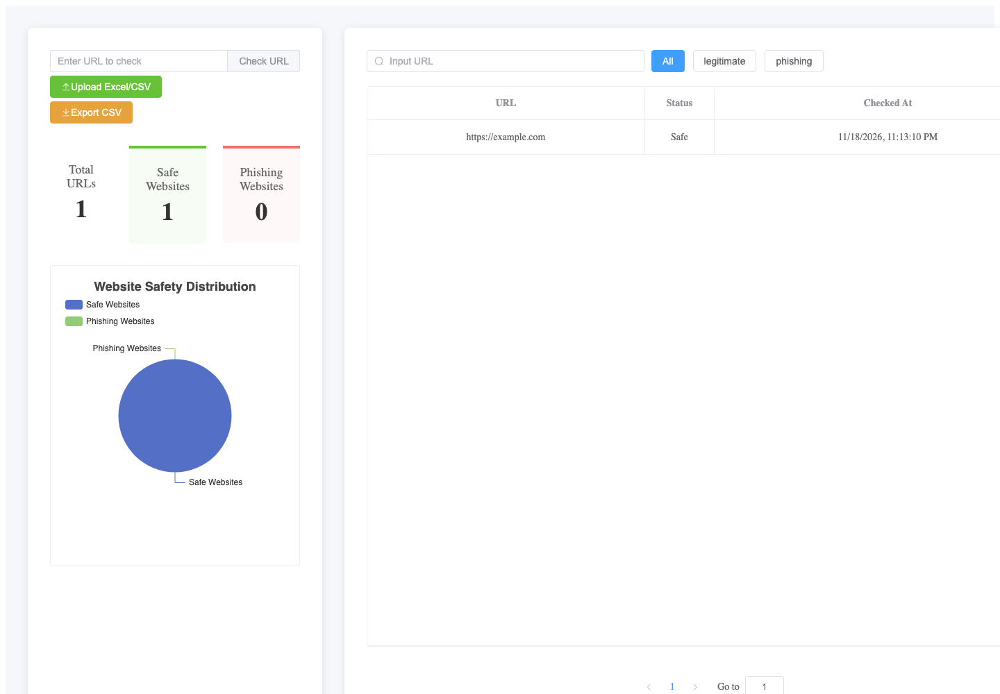
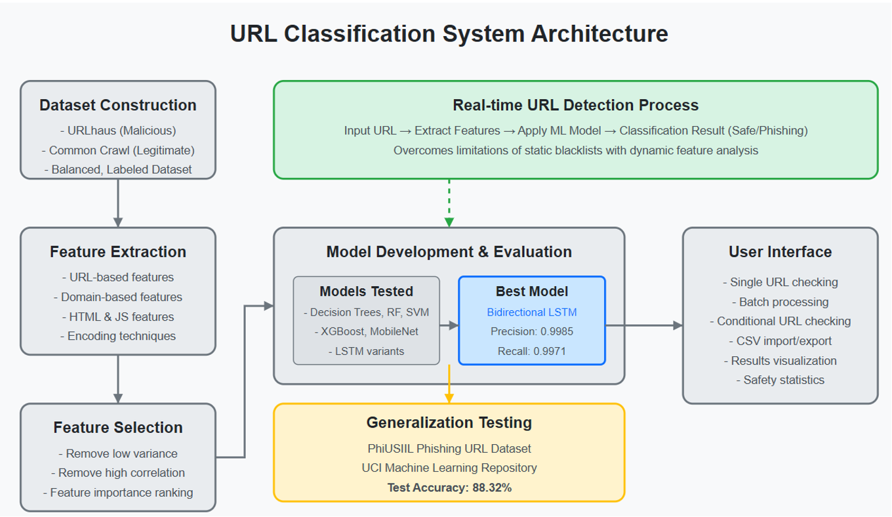

<div align="center">

# URL Classification — Phishing Detection

**Feature-driven URL analysis with a Bi-LSTM model, Flask API, and Vue dashboard.**

A defensive-security project that combines URL, domain, DNS, HTML, and JavaScript features to classify websites as legitimate or potentially malicious, with single-URL checks, CSV batch processing, and result visualisation.

[](https://www.python.org/)
[](https://pytorch.org/)
[](https://flask.palletsprojects.com/)
[](https://vuejs.org/)
[](#verification)

[Overview](#overview) · [Pipeline](#pipeline) · [Quick Start](#quick-start) · [API](#api) · [Evaluation](#evaluation) · [Limitations](#limitations)

</div>

---



<a id="overview"></a>
## 1. Overview

Static browser blocklists are reactive: a newly registered phishing page may not appear in a list until after users are exposed. This project explores a feature-driven alternative that extracts measurable signals from a URL and its host, then applies classical machine-learning or neural models.

The included application connects the full workflow:

1. Submit one URL or a CSV containing a `url` column.
2. Extract lexical, domain, DNS, and page-content features.
3. Run the included Bi-LSTM pipeline.
4. Display predictions, safety totals, history, and charts in a Vue dashboard.
5. Export filtered results as CSV.

> This is a defensive-security research project, not a guarantee that a URL is safe. Predictions should support a warning or review workflow rather than become the only blocking decision.

<a id="pipeline"></a>
## 2. Data and Model Pipeline



| Stage | Implementation |
|---|---|
| **Malicious samples** | URLhaus feed, as documented by the original project |
| **Legitimate samples** | Common Crawl CDX sampling |
| **Feature extraction** | URL and lexical signals, registration and DNS information, HTML and JavaScript hints |
| **Feature selection** | Low-variance pruning, correlation analysis, and model importance |
| **Models** | Classical ML baselines, CNN variants, and Bi-LSTM models |
| **Application model** | `best_fold4.joblib` with preprocessing metadata and a two-layer bidirectional LSTM |
| **External evaluation** | Historical PhiUSIIL experiment documented below |

Prepared datasets, training and evaluation scripts, model checkpoints, and the web application are preserved in the repository. Large model artefacts are retained because the current API loads one of them directly.

## 3. Quick Start

### Backend

**Requirements:** Python 3.10+ and the packages in `requirements.txt`.

```bash
git clone https://github.com/Cjj040721/URL-Classification-Phishing-Detection.git
cd URL-Classification-Phishing-Detection
python3 -m venv .venv
source .venv/bin/activate
python -m pip install -r requirements.txt

cd "src/User_interface/back-end code"
python main.py
```

The API listens on **port 5001**. macOS uses port 5000 for AirPlay Receiver, so this project uses 5001 to avoid that conflict.

Test the running service:

```bash
curl http://127.0.0.1:5001/

curl -X POST http://127.0.0.1:5001/detect \
  -H 'Content-Type: application/json' \
  -d '{"url":"https://example.com"}'
```

### Frontend

In a second terminal, from the repository root:

```bash
cd "src/User_interface/front-end code"
npm ci
npm run dev
```

Open `http://localhost:5173`. The dashboard defaults to `http://localhost:5001`. To use a different API address:

```bash
VITE_API_BASE_URL=http://127.0.0.1:5001 npm run dev
```

<a id="api"></a>
## 4. HTTP API

| Route | Method | Input | Result |
|---|---|---|---|
| `/` | GET | None | Backend welcome message |
| `/detect` | POST | `{ "url": "https://example.com" }` | Original URL, class, prediction, and model probability |
| `/upload_csv` | POST | Multipart CSV file with a `url` column | Batch prediction results and total count |
| `/export_csv` | POST | `{ "data": [...] }` | CSV response containing the supplied records |

Real verification response for `https://example.com` on the included model:

```json
{
  "class": 0,
  "original_url": "https://example.com",
  "prediction": "legitimate",
  "probability": 0.002650746377184987
}
```

Model outputs vary with feature availability and model version. This response is evidence of an executed request, not a universal judgement about the domain.

<a id="evaluation"></a>
## 5. Historical Evaluation

The original project documentation reports the following results. They are retained as historical project results and **were not retrained or independently recomputed during this documentation update**.

| Experiment | Reported result |
|---|---:|
| Bi-LSTM precision | 0.9985 |
| Bi-LSTM recall | 0.9971 |
| Bi-LSTM F1 | 0.9978 |
| Bi-LSTM ROC-AUC | 0.9991 |
| External PhiUSIIL accuracy | 88.32% |

Training, evaluation, feature-engineering, and generalisation notebooks are included under `src/Models_and_evaluations/` for inspection and further reproduction work.

<a id="verification"></a>
## 6. Verification

| Check | Result |
|---|---|
| Frontend production build | Passed with Vite |
| Backend module import | Passed in a clean virtual environment |
| Real backend request | `/detect` completed for `https://example.com` using `best_fold4.joblib` |
| Real browser workflow | URL submitted through the Vue UI; Safe result, statistics, and chart updated |
| README screenshot | Captured from that real end-to-end request, not a mock dashboard |

The frontend build reports a large-chunk warning and npm reports dependency advisories; neither is hidden or represented as a security audit. No automated test suite was present in the original repository.

## 7. Repository Structure

```text
URL-Classification-Phishing-Detection/
├── data/                          # Prepared datasets and feature matrices
├── docs/
│   ├── architecture.png           # Pipeline diagram
│   └── assets/dashboard.png       # Real application screenshot
├── src/
│   ├── Dataset_construction/      # Dataset generation scripts
│   ├── Feature_engineering/       # Feature extraction and selection
│   ├── Models_and_evaluations/
│   │   ├── Machine_Learning/      # Classical baselines
│   │   ├── CNN/                   # CNN experiments
│   │   └── LSTM/                  # Bi-LSTM training and evaluation
│   └── User_interface/
│       ├── back-end code/         # Flask API and current inference pipeline
│       └── front-end code/        # Vue + Element Plus + ECharts dashboard
├── requirements.txt
└── LICENSE
```

<a id="limitations"></a>
## 8. Limitations and Responsible Use

- Feature extraction can perform WHOIS, DNS, and HTTP requests; network availability changes both latency and feature values.
- The API has no authentication or production deployment controls. Run it locally for research use.
- Batch inference uses concurrent network and model work; a public deployment would need stricter queueing and resource limits.
- Historical metrics do not establish current performance against new phishing campaigns.
- False positives and false negatives remain possible. Do not present a model score as proof of safety.
- Third-party datasets and feeds retain their original terms. The MIT licence applies to this repository's original code, not a new licence for third-party data or models.

## 9. Licence

Original project code is available under the [MIT Licence](LICENSE).

---

<div align="center">

**URL Classification — Inspect the signals behind a link before trusting it.**

Python + PyTorch + Flask + Vue

</div>
